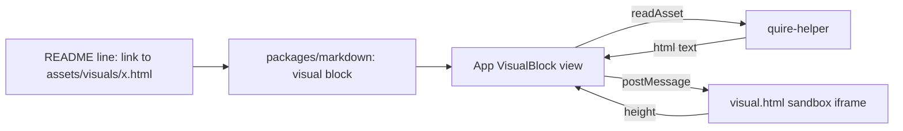

# Interactive Visual blocks

## Decision

Use a dedicated `/visual` slash command and a **Visual** block type, not raw HTML in the page:

- Raw HTML breaks the one-line-one-block model and shows as many Text blocks.
- Manifest V3 forbids inline scripts on `app.html`, so interactive HTML must run in a manifest `sandbox` page.
- Keeping HTML in its own file keeps `README.md` readable and GitHub-friendly. On GitHub the line is just a link.

## Contract (new section in architecture.md, labeled Intended)

- Markdown form: a whole line `[Title](assets/visuals/<name>.html)`, relative to the page folder. Same link-line variants as sub-page links (percent-encoding, angle brackets, `./`). No `..`, no other folders, `.html` only.
- Storage: `<page>/assets/visuals/<slug>.html`. The file must be self-contained, with inline CSS and JS and no network. `assets/` is already never a page.
- Size: 512 KiB, the same limit as `readPage`, to stay under the 1 MiB native-messaging reply limit.
- Helper methods: `readAsset { path }` returns `{ path, content, hash }`, and `writeAsset { path, content, baseHash? }` writes atomically and returns `STALE` when the hash no longer matches. Both use the `helper/src/paths.rs` check and are limited to `assets/visuals/*.html` under a page.
- Rendering: `visual.html` is declared under `manifest.sandbox.pages` with CSP `sandbox allow-scripts; default-src 'none'; script-src 'unsafe-inline'; style-src 'unsafe-inline'; img-src data:`. The app sends the HTML by `postMessage`. The sandbox has no `chrome.*` access and no network, and it reports its content height back so the block can resize, up to a cap.

## Roadmap change ([ROADMAP.md](ROADMAP.md))

- Insert **slice 14, Visual blocks**, after rich blocks. Renumber search, AI setup, AI writing, and settings to 15 through 18.
- Slice 14: the parser, helper asset methods, sandboxed rendering, and `/visual` with **Import file** and **Paste HTML**.
- Slice 17, AI writing: adds **Generate with AI** to `/visual`. A prompt template asks for one self-contained HTML document with no external resources, and the user previews it before inserting.

## Work items for slice 14

1. **Docs first:** the architecture section above, a `plan.md` block-mapping row (`/visual`), a new [blueprints/visual-blocks.md](blueprints/visual-blocks.md) plus its manifest entry in [blueprints/README.md](blueprints/README.md), a diagram in `assets/diagrams/visual-block.mmd`, and a wireframe of the block and the `/visual` dialog in `assets/wireframes/`.
2. **Markdown:** add `{ type: "visual"; title: string; file: string }` in [packages/markdown/src/blocks.ts](packages/markdown/src/blocks.ts), detected before the generic link rule in `src/links.ts`. Test the byte-exact round trip and rejected forms.
3. **Helper:** add `readAsset` and `writeAsset` in a new `helper/src/assets.rs`, plus the asset-path rule in `paths.rs`. Add cargo tests for traversal, wrong folder, wrong extension, size, and stale hash.
4. **Extension sandbox:** add a `visual.html` entry to [apps/extension/vite.config.ts](apps/extension/vite.config.ts) and the manifest, a `src/visual/` loader, and `src/app/blocks/VisualBlock.tsx`. The block shows a title bar, an open-source-file action, loading and error states, and a resizing iframe.
5. `**/visual` command:** the dialog takes a title, which becomes the slug, with `-2`, `-3` added when a name is taken, plus an HTML file picker or a paste area. It writes the asset, then inserts the link line through the slice 6 save path.
6. **E2E:** a Visual block renders and its script runs; the sandbox cannot reach `chrome.runtime` or the network; and importing through `/visual` creates the file and the link line.

## Risks

- Generated or imported scripts are untrusted. The sandbox CSP plus `default-src 'none'` is the main safeguard, so it needs an e2e test.
- Visuals that load CDN libraries such as D3 won't run. This is intended, and the dialog says so.